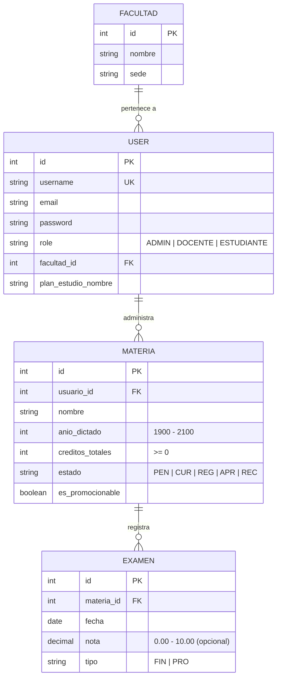

# Plataforma de Gestión de Carrera e Historial Académico

Sistema integral para la administración, seguimiento y planificación de la trayectoria académica de estudiantes universitarios. Permite centralizar el plan de estudios, registrar el estado de cursada por materia, administrar mesas de examen final e historial de calificaciones, y visualizar el progreso general de la carrera mediante indicadores dinámicos y lógica de semáforo.

---

## 🌐 Despliegue en Producción (Cloud Deployment - TP10)

- **Frontend Web en Vivo**: [https://academicogestor.vercel.app](https://academicogestor.vercel.app)
- **API REST Pública en Vivo**: [https://gestor-apo.onrender.com/api](https://gestor-apo.onrender.com/api)
- **Documentación Swagger / OpenAPI**: [https://gestor-apo.onrender.com/api/docs/](https://gestor-apo.onrender.com/api/docs/)
- **Monitoreo / Health Check**: [https://gestor-apo.onrender.com/api/health/](https://gestor-apo.onrender.com/api/health/)

---

## 🎯 Objetivos del Proyecto

- **Objetivo General**: Desarrollar una solución web modular (Backend RESTful + Frontend SPA) para gestionar el progreso académico, calificaciones y mesas de examen con control de acceso por roles e integridad de datos.
- **Objetivos Específicos**:
  - Implementar autenticación y autorización segura con JWT (JSON Web Tokens) y control de acceso basado en roles (RBAC).
  - Proveer endpoints CRUD con aislamiento estricto de recursos por usuario y permisos diferenciados (`ADMIN`, `DOCENTE`, `ESTUDIANTE`).
  - Validar reglas de negocio críticas a nivel de serializadores y modelos (rango de notas 0-20, años lectivos válidos, créditos positivos, unicidad de cuentas).
  - Desarrollar una interfaz de usuario interactiva y responsive con React 19, Vite y Bootstrap 5.3.
  - Garantizar calidad del software mediante **TDD (Test-Driven Development)** y principios de **Clean Code**.

---

## 🧭 Evolución y Alcance por Trabajos Prácticos

El repositorio reúne de forma progresiva las metas establecidas a lo largo de la cursada:

| Trabajo Práctico | Enfoque Principal | Entregables y Logros |
| :--- | :--- | :--- |
| **TP 1** | Puesta en marcha Backend | Entorno virtual, configuración base de Django y Django REST Framework, middleware CORS, smoke tests de infraestructura y superusuario. |
| **TP 2** | Modelado de datos y CRUD | Modelos `Facultad`, `Materia`, `Examen`, integración con PostgreSQL, ViewSets, enrutamiento, pruebas de contrato de entidades y documentación Swagger UI vía `drf-spectacular`. |
| **TP 3** | Seguridad e Identidad | App `users`, modelo personalizado `User` (`AbstractUser`), roles (`ADMIN`, `DOCENTE`, `ESTUDIANTE`), autenticación JWT (`/api/token/`, `/api/token/refresh/`), lista negra de tokens, propiedades semánticas y permisos personalizados. |
| **TP 4** | Validación de API y Casos de Borde | Matriz de 61 pruebas, validaciones de rango (notas 0-20, año 1900-2100, créditos $\ge$ 0), casos de borde de modelos, aislamiento de datos por usuario, bypass administrativo y resolución de 10 bugs mediante pull requests. |
| **TP 5** | Inicio del Frontend React | Inicialización del cliente web SPA en `Frontend/` con Vite y React 19 en puerto 3000, scripts npm, arquitectura monorepo y diseño inicial de Home. |
| **TP 6** | Maquetado Responsive (Bootstrap) | Interfaz completa de Home modularizada: Hero section, tarjetas de métricas (`StatCard`), monitor de avance (`ProgressCard`), plan de estudio (`PlanEstudioCard`), mesas de examen (`MesasExamenCard`), Navbar colapsable con logo e isotipo SVG y Footer accesible libre de desbordes. |
| **TP 7** | Sistema Auth en Frontend | Contexto global de autenticación (`AuthContext` + `useAuth`), rutas protegidas (`ProtectedRoute`), vistas completas de `Login` y `Register` con validaciones y alertas, y flujo de cierre de sesión (`Logout`). |
| **TP 8** | **Conexión Frontend con Backend** | Conexión integral de la SPA con Django REST Framework y SimpleJWT. Variables de entorno (`VITE_API_URL`), configuración CORS para Vite (`localhost:5173`), cliente HTTP desacoplado (`api.js`), almacenamiento seguro de tokens JWT (`storage.js`), autenticación real (login/register asíncronos), persistencia de sesión por token (`/api/users/me/`), lista negra en logout (`/api/logout/`), Home dinámica consumiendo `/api/materias/` y `/api/examenes/`, y suite automatizada con 53 tests en Frontend y 54 tests en Backend bajo TDD y Clean Code. |
| **TP 9** | **Vistas Completas de Usuario y Auditoría** | Implementación de vistas CRUD completas (`MateriasList`, `MateriaDetail`, `ExamenesList`, `Profile`), importación/exportación masiva en CSV, servicio de historial de cambios y auditoría local (`activityLogService`), protección de rutas por roles (`RoleProtectedRoute`), y sincronización bidireccional automática del estado de aprobación de asignaturas (`sincronizar_estado_aprobacion`). |
| **TP 10** | **Despliegue en la Nube (Producción)** | Publicación de la API en Render con base de datos PostgreSQL, servicio de estáticos comprimidos con WhiteNoise, servidor WSGI Gunicorn, endpoint activo de salud (`GET /api/health/`), despliegue del frontend SPA en Vercel con rewrites para navegación limpia, y documentación completa del proceso de deploy. |

---

## 🏗️ Arquitectura del Sistema

El proyecto está diseñado como un monorepositorio que separa claramente las responsabilidades del servidor API y del cliente web:

```
Programaci-n-1/
├── Gestor/               # Configuración global del proyecto Django (settings, urls, asgi, wsgi)
├── core/                 # App académica: modelos Facultad, Materia, Examen, endpoints CRUD y tests
├── users/                # App de identidad: modelo User personalizado, serializadores, permisos RBAC y tests
├── docs/                 # Matriz de pruebas de TP4 y colección de Postman
├── Frontend/             # Cliente Single Page Application (SPA)
│   ├── .env.example      # Plantilla de variables de entorno (VITE_API_URL)
│   ├── src/
│   │   ├── components/   # Componentes reutilizables (Navbar, Footer, StatCard, ProgressCard, PlanEstudioCard, MesasExamenCard, ProtectedRoute)
│   │   ├── contexts/     # Context API para estado de autenticación (AuthContext)
│   │   ├── data/         # Mock data inicial para desarrollo
│   │   ├── hooks/        # Custom hooks (useAuth)
│   │   ├── services/     # Capa de servicios y comunicación HTTP (api.js, storage.js, authService.js, academicService.js)
│   │   ├── utils/        # Utilidades puras testeadas (progress.js, auth.js)
│   │   └── views/        # Vistas de la aplicación (Home, Login, Register)
│   └── package.json      # Dependencias y scripts de Node.js
└── requirements.txt      # Dependencias de Python
```

---

## 📐 Modelo de Datos y Relaciones



### Reglas de Integridad y Lógica de Negocio
1. **Cascada (`CASCADE`)**: La eliminación de un usuario remueve sus materias y exámenes dependientes.
2. **Aislamiento de Recursos**: Los estudiantes solo pueden consultar y operar sobre sus propias materias y exámenes asociados.
3. **Bypass Administrativo**: El rol `ADMIN` posee visibilidad global y permisos de modificación/eliminación sobre cualquier recurso académico.
4. **Protección de Facultades**: La lectura de facultades es pública; su alta, baja y modificación está reservada al administrador (`IsAdminOnly`).
5. **Sincronización Bidireccional de Aprobación**: Registrar un examen final o promoción con nota $\ge$ 6 conmuta automáticamente la materia a `APR`. Si el examen se elimina o degrada a aplazo, revierte a `REG`.

---

## 🔌 Endpoints de la API REST

Documentación interactiva disponible en Swagger UI:
- **Producción**: [https://gestor-apo.onrender.com/api/docs/](https://gestor-apo.onrender.com/api/docs/)
- **Local**: `http://localhost:8000/api/docs/`

| Método | Endpoint | Rol Requerido | Descripción |
| :--- | :--- | :--- | :--- |
| `GET` | `/api/health/` | Público | Health check activo con monitoreo de base de datos PostgreSQL (TP10). |
| `POST` | `/api/token/` | Público | Obtiene par de tokens JWT (`access` y `refresh`). |
| `POST` | `/api/token/refresh/` | Público | Renueva el token de acceso mediante el token de actualización. |
| `POST` | `/api/logout/` | Autenticado | Invalida el refresh token agregándolo a la lista negra (`TokenBlacklist`). |
| `POST` | `/api/users/register/` | Público | Registro de nuevos usuarios (rol inicial `ESTUDIANTE`). |
| `GET` | `/api/users/me/` | Autenticado | Obtiene la información del perfil del usuario en sesión. |
| `GET` | `/api/facultades/` | Público | Lista todas las facultades registradas. |
| `POST` | `/api/facultades/` | `ADMIN` | Registra una nueva facultad institucional. |
| `GET` | `/api/facultades/{id}/`| Público | Obtiene el detalle de una facultad específica. |
| `PUT/PATCH/DELETE` | `/api/facultades/{id}/` | `ADMIN` | Modifica o da de baja una facultad. |
| `GET` | `/api/materias/` | Autenticado | Lista materias propias (los `ADMIN` ven todas). |
| `POST` | `/api/materias/` | Autenticado | Crea una materia (asignación automática del autor autenticado). |
| `GET` | `/api/materias/{id}/` | Propietario / `ADMIN` | Obtiene el detalle de una materia. |
| `PUT/PATCH/DELETE` | `/api/materias/{id}/` | Propietario / `ADMIN` | Modifica o elimina una materia propia. |
| `GET` | `/api/examenes/` | Autenticado | Lista mesas de examen asociadas a materias propias. |
| `POST` | `/api/examenes/` | Autenticado | Registra mesa de examen para una materia propia (o cualquiera si es `ADMIN`). |
| `PUT/PATCH/DELETE` | `/api/examenes/{id}/` | Propietario / `ADMIN` | Modifica o elimina una mesa de examen asociada a su materia. |

---

## 🎨 Frontend (React + Vite + Bootstrap)

El cliente web se encuentra en el directorio [`Frontend/`](file:///home/alejrz/prog/Programaci-n-1/Frontend/README.md).

### Características Destacadas
- **Enrutamiento Declarativo**: Configurado con `react-router-dom` v7. Rutas públicas (`/login`, `/register`) y rutas protegidas (`/`) mediante el componente guard [`ProtectedRoute`](file:///home/alejrz/prog/Programaci-n-1/Frontend/src/components/ProtectedRoute.jsx).
- **Context API (`AuthContext`)**: Manejo centralizado del estado de sesión, métodos de autenticación, validación de credenciales y persistencia en memoria para desarrollo.
- **Monitor de Avance y Semáforo Académico**: Cálculo desacoplado en [`progress.js`](file:///home/alejrz/prog/Programaci-n-1/Frontend/src/utils/progress.js):
  - 🔴 **Crítico / Inicio**: 0% a 39% de créditos obtenidos (`text-bg-danger`).
  - 🟡 **En Proceso**: 40% a 74% de créditos obtenidos (`text-bg-warning`).
  - 🟢 **Avanzado / Completado**: 75% a 100% de créditos obtenidos (`text-bg-success`).
- **Paleta de Diseño**: Integración sobre variables SCSS/CSS de Bootstrap con color primario terracota (`#c05621`), garantizando contraste accesible WCAG AA.

---

## 🧪 Pruebas Automatizadas y Metodología TDD

El proyecto cuenta con suites de prueba automatizadas tanto en el backend como en el frontend, diseñadas bajo el ciclo **Red → Green → Refactor**:

### 1. Pruebas de Backend (Django Test Suite)
Ejecuta 72 pruebas automáticas de integración, comportamiento, infraestructura, casos de borde y contratos de API:
```bash
python manage.py test core users
```
**Casos cubiertos:**
- **Infraestructura y Configuración Base (TP1)**: Verificación de `INSTALLED_APPS`, orden y prioridad de `CorsMiddleware` y disponibilidad del panel administrativo (`/admin/login/`).
- **Modelado de Datos y OpenAPI (TP2)**: Representación semántica de entidades (`__str__` en `Facultad`, `Materia`, `Examen`) y disponibilidad pública de Swagger UI (`/api/docs/`) y esquema OpenAPI (`/api/schema/`).
- **Identidad, Seguridad y Roles (TP3)**: Autenticación JWT (login exitoso, credenciales inválidas, refresh de token, lista negra), registro con validación obligatoria y única de email/username, propiedades semánticas de roles (`is_admin`, `is_docente`, `is_estudiante`) y consulta de perfil propio (`/api/users/me/`).
- **Casos de Borde y Reglas de Negocio (TP4)**: Rechazo de choices inválidos en estados de materia y tipos de examen, nombres en blanco, validaciones de rango (notas 0-10, años lectivos 1-10 o 1900-2100, créditos no negativos), soporte de nota nula (examen pendiente) y resolución de bugs de la matriz de pruebas.
- **Sincronización Bidireccional de Dominio (TP9)**: Método `materia.sincronizar_estado_aprobacion()` que conmuta a `APR` con examen aprobado y restituye a `REG` si se degrada o elimina.
- **Despliegue y Monitoreo en la Nube (TP10)**: Endpoint `GET /api/health/` con verificación activa de conectividad con la base de datos PostgreSQL.
- Aislamiento multi-inquilino por usuario en consultas GET, POST, PATCH y DELETE con prevención estricta de IDOR.

### 2. Pruebas de Frontend (Node.js Native Test Runner)
Ejecuta 161 pruebas unitarias y de integración bajo TDD estricto:
```bash
npm --prefix Frontend test
```
**Casos cubiertos:**
- **Progreso Académico y Semáforo (`progress.test.js`)**: Redondeo y cálculo de porcentaje de créditos, clasificación estricta de semáforo (0-39, 40-74, 75-100), badges semánticos, cálculo de promedios con aplazos y sin aplazos.
- **Servicios de Comunicación API (`api.test.js`)**: Manejo de errores traducidos al español, interceptor de autenticación Bearer, singleton lock para refresco de tokens concurrentes sin race conditions.
- **Servicio de Autenticación (`authService.test.js`)**: Login, registro, logout con blacklist, refresco y sesión persistida.
- **Servicio Académico (`academicService.test.js`)**: Operaciones CRUD completas de materias y exámenes, dashboard consolidado y paginación.
- **Control de Acceso y Rutas Protegidas (`roles.test.js` y `RoleProtectedRoute.test.js`)**: Verificación de permisos RBAC para estudiantes, docentes y administradores.
- **Historial de Auditoría Local (`activityLogService.test.js`)**: Registro cronológico de acciones y vaciado seguro.

---

## ⚙️ Puesta en Marcha Local

### Requisitos Previos
- **Python**: 3.13 o superior
- **Node.js**: 18.0 o superior (con npm)
- **PostgreSQL**: Instalado localmente o vía Docker

### 1. Configuración del Backend

1. **Crear y activar el entorno virtual**:
   ```bash
   python -m venv .venv
   source .venv/bin/activate       # En Linux/macOS
   # .venv\Scripts\activate       # En Windows
   ```

2. **Instalar dependencias**:
   ```bash
   pip install -r requirements.txt
   ```

3. **Variables de entorno**:
   Crear un archivo `.env` basado en `.env.example`:
   ```env
   SECRET_KEY=django-insecure-development-key-32-chars-long
   DEBUG=True
   ALLOWED_HOSTS=localhost,127.0.0.1
   DB_NAME=programacion1_db
   DB_USER=postgres_django_user
   DB_PASSWORD=secret
   DB_HOST=localhost
   DB_PORT=5432
   ```

4. **Base de Datos (Docker opcional)**:
   Si dispone de Docker:
   ```bash
   docker compose up -d
   ```

5. **Aplicar migraciones y crear superusuario**:
   ```bash
   python manage.py migrate
   python manage.py createsuperuser
   ```

6. **Iniciar el servidor API**:
   ```bash
   python manage.py runserver
   ```
   El servidor estará disponible en `http://127.0.0.1:8000/`.

---

### 2. Configuración del Frontend

1. **Instalar dependencias**:
   ```bash
   cd Frontend
   npm install
   ```

2. **Variables de entorno**:
   Copiar la plantilla `.env.example` a `.env` (si aún no existe):
   ```bash
   cp .env.example .env
   ```
   Contenido configurado:
   ```env
   VITE_API_URL=http://localhost:8000/api
   ```

3. **Ejecutar en modo de desarrollo**:
   ```bash
   npm run dev
   ```
   La aplicación se abrirá en `http://localhost:5173/` (o `http://localhost:3000/`).

4. **Comandos útiles de verificación**:
   ```bash
   npm test        # Ejecuta las 53 pruebas unitarias (node:test)
   npm run lint    # Ejecuta el análisis estático con ESLint (0 errores, 0 advertencias)
   npm run build   # Genera el bundle compilado de producción con Vite
   ```

---

## 🧼 Principios de Clean Code Aplicados

1. **Nombres Significativos e Intención Reveladora**: Constantes descriptivas (`SEMAFORO`, `ESTADO_BADGE`, `User.Role.ADMIN`), evitando números mágicos y cadenas repetidas.
2. **Funciones Pequeñas con Responsabilidad Única**: Separación de subcomponentes visuales (`StatCard`, `ProgressCard`, `PlanEstudioCard`, `MesasExamenCard`) y utilidades puras (`calcularPorcentaje`, `obtenerSemaforo`).
3. **Manejo Seguro de Errores y Validaciones**: Serializadores con validaciones explícitas de bordes y mensajes de error orientados a seguridad (mensajes genéricos en login para evitar enumeración de usuarios).
4. **Pruebas en Seams Públicos (TDD)**: Pruebas unitarias y de integración que verifican el contrato público de los endpoints y módulos, garantizando refactorizaciones seguras.

